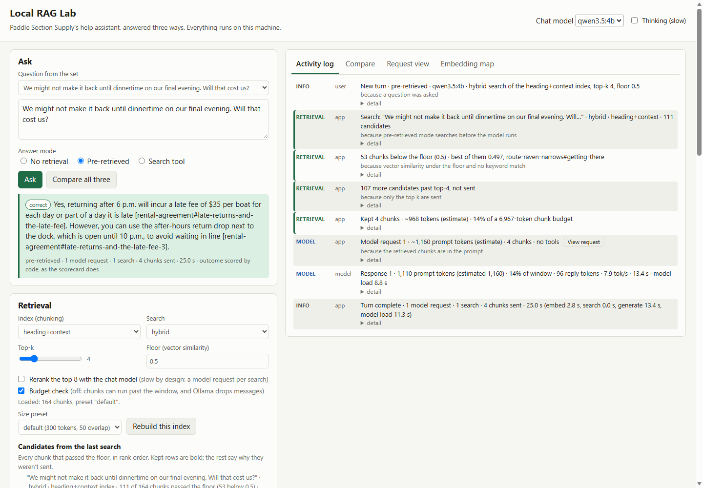

# Local RAG Lab

**One help assistant, three ways to ground its answers, and every retrieved chunk, score and token on screen. A teaching lab for retrieval-augmented generation that runs entirely on your machine. No API key, no hosted model.**

The assistant works for **Paddle Section Supply**, an invented canoe and
kayak outfitter, and answers customer questions from 25 of its documents:
rental terms, rate sheets, permit rules, route guides, gear guides and
FAQs. The models run locally through [Ollama](https://ollama.com). You
pick how each answer is grounded:

| Mode | Who retrieves | What the log shows |
|---|---|---|
| **No retrieval** | nobody | one small request; the model answers from what it knows, or declines |
| **Pre-retrieved** (classic RAG) | the app, before the model runs | a search with every candidate and score, then one request with the chunks pasted inside it |
| **Search tool** (agentic RAG) | the model, by calling `search_docs` | a request, the model's own search query, the results, a second request |

RAG is usually taught as a box diagram: documents, embeddings, a vector
database, a model. The diagram hides the part that matters to a
developer: what actually lands in the model's request, and what it
costs. This lab shows exactly that:

- the query that was embedded, and in search-tool mode the query the model wrote;
- every candidate chunk, with its vector score, keyword (BM25) rank, fused
  rank and, when reranking is on, its rerank score;
- which chunks were kept, and why each of the rest was dropped (below the
  floor, past top-k, over the token budget);
- the full request the model received, with every chunk highlighted inside it;
- prompt tokens (estimated and real), time per stage, and the share of the context window used;
- where the question landed on a 2D map of the embeddings.

If something happens and the UI doesn't show it, that's a bug.



For a guided tour of the pipeline, with code and screenshots from real
runs, see [How it works](docs/how-it-works.html). Every number in this
README comes from [the scorecard](docs/scorecard.md) or from
[docs/verified-facts.md](docs/verified-facts.md), and both say how they
were measured.

---

> **Not for deployment.** This is built to be read and watched. It has no
> authentication and binds to localhost only. The outfitter, its
> documents, products and places are invented; every domain is `.example`.

---

## What you need

| | |
|---|---|
| **Node.js** | 24 or newer (the index is read with the built-in `node:sqlite`) |
| **Ollama** | Installed and running: [ollama.com/download](https://ollama.com/download) |
| **A chat model** | `qwen3.5:4b` (3.3 GB). `llama3.2:3b` (2.0 GB) is selectable but optional |
| **An embeddings model** | `nomic-embed-text` (274 MB) |
| **Memory** | Measured on a laptop with 32 GB RAM and a 4 GB GPU: at an 8,192-token window, qwen3.5:4b loads partly on the GPU, which leaves room for the embeddings model beside it, so a question never waits for a model swap. No GPU works too, just slower |
| **An API key** | **No.** Nothing in this repo calls a hosted model |

## Setup

```bash
npm install
ollama pull qwen3.5:4b
ollama pull nomic-embed-text
npm run index         # chunks and embeds the corpus: three index files, about 8 s on the GPU
npm run check-env     # checks each piece separately and says what to fix
npm run dev           # http://127.0.0.1:3400
```

`npm run check-env` fails loudly on anything that would break the
local-only promise: an `OLLAMA_URL` pointing at another machine, or a
model name that Ollama would run in its cloud. It also fails when an
index is missing, was built from an older version of the corpus, or was
embedded with a different model than `EMBED_MODEL`.

Settings live in `.env` (copy `.env.example`); every one has a working default.

## Why it's local

The point of the lab is to watch every byte that reaches the model, and
the simplest way to be sure nothing else does is for nothing to leave
the machine. The chat model and the embeddings model both run in Ollama
on `127.0.0.1`; the corpus and its indexes are files in this folder. A
cloud model name is refused by name before any request is sent, in the
model client, the embedder and the web server, whatever Ollama's own
settings say.

## What the lab measured

`npm run eval` scores everything with code; no model judges anything.
It takes about 10 minutes. Highlights from
[docs/scorecard.md](docs/scorecard.md) (qwen3.5:4b, default settings):

**Retrieval** (did the chunks holding the answer come back in the top 4?
27 answerable questions, 27 search configurations):

- The default index, `heading+context`, found 21 of 27 in hybrid mode.
  It was chosen by a rule written before the first run. Plain `heading`
  found 19, `fixed` 16.
- Embedding each chunk with its heading path is what made the
  difference: a chunk that says only "they cost nothing" ranked #15 under
  `heading` and #3 under `heading+context`.
- Hybrid search can bury vector search's best hit. For "Can our pup come
  along on the trip?", vector search ranks the dog answer #1 and hybrid
  #13: the keyword query includes "trip", which matches most of the
  corpus, and reciprocal rank fusion rewards chunks that both searches
  return over a chunk only one of them ranks first. Fusing only each
  list's top N is the usual fix; the lab leaves it visible instead.
- Reranking the top 8 with the chat model raised hits from 21 to 23, at
  3.9 s per search.

**Answers** (30 questions × 3 modes):

| Mode | correct | declined | invented |
|---|---|---|---|
| No retrieval | 0 | 28 | 2 |
| Pre-retrieved | 20 | 7 | 2 |
| Search tool | 21 | 6 | 1 |

(The rest flagged that the 2025 and 2026 rate sheets disagree. The
no-retrieval row includes a hand audit of two answers the scorer
misclassified; PLAN.md §8 has the details.)

- **Retrieval caps answer quality.** With every chunk it needed in the
  prompt, the model answered correctly 40 of 43 times across both modes
  and never invented; every invented answer from a retrieval mode came
  from a prompt missing part of the answer, or holding the stale 2025
  rate sheet.
- **Without documents, qwen mostly declines**, because the system prompt
  says to answer only from documents. Its two inventions are the danger
  in miniature: a "$15 per person" late fee (it's $35 per boat), with a
  citation to a chunk it was never shown.
- **The stale rate sheet beat every mode** (0 of 2), and so did the
  three multi-hop questions: the model searched exactly once on 28 of 30
  questions and never twice, so search-tool mode never got the second
  document a multi-hop question needs.

**How repeatable is one run?** Close, not exact. A second run of the
answer and rerank passes, with the same settings, matched the scorecard
on 89 of 90 answers and on every rerank result. The one that changed:
in search-tool mode, "Can our pup come along on the trip?" went from a
search and a correct answer to no search and a decline, and stayed that
way on five more runs. Temperature 0 and a fixed seed narrow the
variation; they don't remove it, and the decision whether to search is
where a near-tie shows.

## Try these

Start the lab, pick each question from **Question from the set**, and press **Compare all three**:

1. *We might not make it back until dinnertime on our final evening. Will that cost us?*
   Watch no-retrieval invent a fee and cite a chunk it never saw, then
   open **View request** on the pre-retrieved run to see the real fee
   paragraph highlighted inside the prompt.
2. *Can our pup come along on the trip?* The dog answer sits at #13 in
   the candidate table, past top-4. Search-tool mode can rewrite the
   question into a better search, when it chooses to search at all.
3. *How much does it cost to rent a Northline 17 Kevlar canoe for one day?*
   Nothing marks the 2025 rate sheet as old, and retrieval can't tell.
4. *Do day-use permits cost anything?* Ask it with the index set to
   `heading`, then `heading+context`, and watch the answer chunk's rank.
5. *What's the longest portage on the route that starts at EP-14?* The
   answer needs two documents.

Then try the controls: turn **Budget check** off and set top-k to 16 on
an index rebuilt at the `large` preset to push chunks past the window,
or turn on **Rerank** and watch the order change.

## How retrieval works here

- **Chunking** (`shared/chunk.ts`): `fixed` cuts every N tokens;
  `heading` packs whole Markdown sections up to N tokens and cuts only a
  section too big on its own; `heading+context` makes the same cuts but
  embeds each chunk with its document title and heading path in front.
  Three size presets each; changing one means rebuilding that index.
- **Embeddings**: `nomic-embed-text`, 768 numbers per chunk, with the
  `search_document:` and `search_query:` prefixes its model card requires.
- **Search** (`tool-server/search/`): vector search is cosine similarity
  against every chunk in a plain loop; keyword search is SQLite FTS5 with
  BM25; hybrid merges the two rankings by reciprocal rank fusion. A
  similarity floor (0.50) drops chunks only vector search found and that
  score below it.
- **Selection** (`server/context/budget.ts`): the app keeps the top k
  that fit the token budget, and logs every chunk it drops, with the reason.
- **Both retrieval modes call the same `search_docs` tool** over MCP.
  The only difference between classic and agentic RAG is who makes the
  call, and the log's actor column shows which.

### When a real vector database becomes worth it

This lab scores the query against every chunk, in memory, in a loop:
164 chunks take well under a millisecond. A vector database earns its
place when that loop gets too slow (hundreds of thousands of chunks, or
many queries a second), or when the vectors no longer fit in memory. In
exchange it searches an approximate index, so it can miss a few of the
true nearest chunks. Until then, it adds a service and hides the one
computation a reader most needs to see.

### Retrieved text is untrusted input

Every chunk pasted into a prompt is text the model may treat as
instructions. Here the corpus is fixed and reviewed and holds nothing
adversarial, so the lab doesn't explore it; in a real system, anything
retrieved from documents that users or outsiders can edit is an
injection path, and needs the same care as any other untrusted input.

Retrieval is for unstructured text. When the answer lives in structured
records (an order, an account, inventory), a tool that queries those
records directly is usually the better fit than embedding them as text.

## Scripts

| Command | What it does |
|---|---|
| `npm run dev` | The lab on http://127.0.0.1:3400 (compiles the browser half first) |
| `npm run index` | Builds the three indexes (`--strategy`, `--preset` to build one) |
| `npm run check-env` | Checks Node, settings, Ollama, both models and the indexes, separately |
| `npm run ask -- "…"` | One question, one mode (`--mode`), every log row in the terminal (`--verbose` for full requests) |
| `npm run compare -- "…"` | One question through all three modes, and a summary row (`--id` for a question from the set) |
| `npm run eval` | The full scorecard, about 10 minutes; writes `docs/scorecard.md` and `.json` |
| `npm run eval -- --check` | Checks the question set against the corpus in a second, no models needed |
| `npm run eval -- --retrieval` | The retrieval pass only, printed |
| `npm run chunk-report` | Chunk counts per strategy and preset, and the longest and shortest chunks |
| `npm run try-tools` | Calls every MCP tool over stdio, no model: 14 checks |
| `npm run tool-server:http` | The tool server over Streamable HTTP on 127.0.0.1:3401, for MCP Inspector |
| `npm test` | 96 unit tests: chunking, search, fusion, the budget, assembly, scoring |
| `npm run typecheck` | Both halves (Node and browser) |
| `npm run audit-comments` | Checks that every one of the 60 TypeScript files opens with an explanation |

## Project layout

```
corpus/          25 Markdown documents, and README.md listing every planted trap
questions/       30 questions, one JSON file each, with gold spans and required facts
data/            schema.sql (committed); index-<strategy>.db (built, not committed)
tool-server/     the MCP server: the only code that reads the corpus and the indexes
  search/        vector.ts, keyword.ts, fuse.ts, search.ts
  tools/         search_docs, get_document, list_documents, index_map
server/          the app: the three modes, context budget, prompt assembly, rerank, routes
  modes/         none.ts, pre-retrieved.ts, search-tool.ts, and common.ts they share
  context/       budget.ts, assemble.ts, rerank.ts
shared/          chunking, scoring and types both halves use
public/          the browser half, compiled in place
scripts/         index, check-env, ask, compare, eval, try-tools, chunk-report
test/            node:test unit tests
docs/            scorecard, verified facts, how-it-works walkthrough, screenshots
```

## Things that will trip you up

- **Ollama silently truncates embeddings.** By default `/api/embed` cuts
  an over-long input and returns a vector of what fit, with no error. The
  embedder sends `truncate: false`, so it fails loudly instead.
- **FTS5 throws on raw text.** `MATCH 'EP-14'` fails with "no such column:
  14". Keyword search quotes every term before searching.
- **qwen3.5:4b thinks by default.** Every request sends `think: false`
  unless you turn thinking on, and with it on a one-sentence question can
  take minutes. Leaving `think` out lets the model think.
- **Ollama drops messages silently** when a request outgrows `num_ctx`.
  The log catches it by comparing Ollama's prompt-token count with the
  size of the messages sent.
- **Temperature 0 and a fixed seed make runs close to repeatable, not
  exactly.** Two full runs agreed on 89 of 90 answers; the one that
  differed was the model's choice whether to search at all.
- **The token estimate is a heuristic.** Characters ÷ 4 lands within about
  15% without tools, but undercounts by 150–450 tokens when the search
  tool is offered, because the chat template renders a tool definition
  into more tokens than its JSON size suggests.
- **Rebuilding an index stops the tool server first.** It holds the index
  files open, and Windows won't let a build rename a new file over an open
  one. Questions are refused until the build finishes.
- **An index built from an older corpus still works**, and searches chunks
  that no longer match the documents. The UI and `check-env` both say so.
- **llama3.2:3b drops the tool definitions once a tool result is the last
  message**, so in search-tool mode it can search only once.

## Security notes

- Every server binds `127.0.0.1` and checks the Host and Origin headers
  of every API request (`npm run tool-server:http` too), so a web page in
  your browser can't reach the lab through DNS rebinding.
- The browser half renders every piece of corpus text, model output and
  log detail as text, never as HTML: there is no `innerHTML` in `public/`.
- Cloud models are refused by name; `OLLAMA_URL` must be this machine.

## License

MIT. See [LICENSE](LICENSE).
